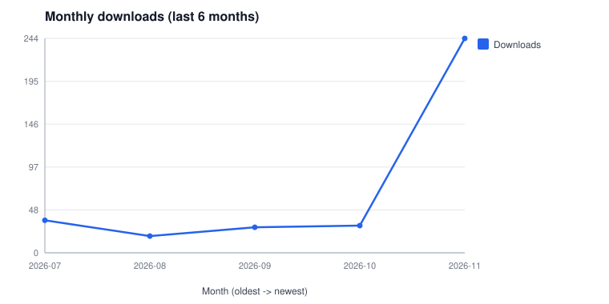
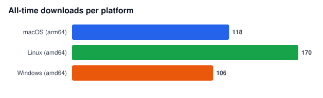
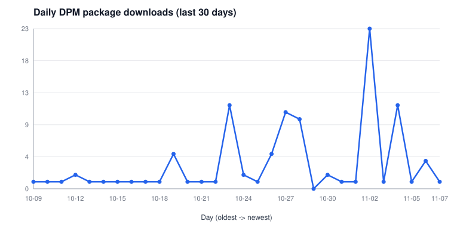

# Download statistics (detailed)

Standalone release-asset downloads and DPM (GHCR package) downloads are
tracked separately. The [README](../README.md#download-statistics) shows
the combined monthly total.

Charts refresh daily from the `release-stats-data` branch.

## Standalone downloads

GitHub Releases assets from `bitdynamics-ab/canton-devkit` and
`bitdynamics-ab/homebrew-canton-devkit` (merged by tag).

## DPM package downloads

GHCR package installs from
[GitHub Packages](https://github.com/bitdynamics-ab/canton-devkit/pkgs/container/canton-devkit).

